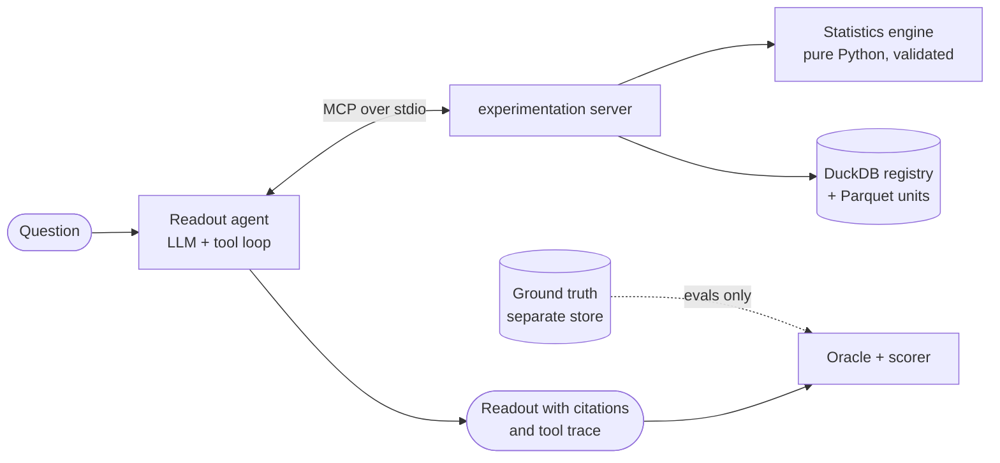

# Experimentation Copilot

[](https://github.com/giteshpoudel/experiment-copilot/actions/workflows/ci.yml)

**An MCP server that lets an AI assistant analyze A/B tests with validated statistics, and an
eval harness that measures whether it actually reaches the right ship decision.**

Ask *"Should we ship checkout-redesign?"* and the assistant checks the traffic split, picks the
right test for each metric, applies the decision rule the team pre-registered, and writes a
readout in which every number links back to the tool result it came from.

> **The core rule:** numbers come from tools. The model chooses methods and explains them; it
> never computes, rounds or converts a number itself.

---

## Why build it this way

Language models are good at explaining experiments and unreliable at doing the statistics.
Given only a summary table, a strong model will compute standard errors in its head, compare a
relative margin against an absolute difference, or call a result significant after two weeks
of daily peeking. Each of these looks plausible and leads to a wrong decision.

So the statistics live in a server the model can call but cannot second-guess:

- **Tools take experiment ids and metric names, never raw data.** Data stays in the store and
  results come back small and typed.
- **Every result carries a stable `result_id`** and a pre-formatted summary
  (`+11.6% (95% CI +4.18% to +19%), p = 0.0012`) that the model quotes verbatim.
- **The decision rule is data, not taste.** Each experiment has a pre-registered plan (primary
  metric, guardrails, MDE, alpha, planned n, interim looks, CUPED covariate), and the readout
  must follow it.
- **The tools are read-only.** The server cannot create, change or stop experiments.

## How it works



A typical readout runs `describe_experiment` → `check_srm` → `analyze_metric` (primary, then
guardrails) → `adjust_pvalues` when there are several arms → `sequential_test` or
`daily_effects` when the design calls for them. The agent labels each result `[r1]`, `[r2]` …
and the trace maps every label to the tool, its inputs and the server's `result_id`.

<details>
<summary>Example: a readout the agent wrote (abridged)</summary>

```
## Decision: INVALID

## Validity checks (SRM, peeking, novelty)
- SRM: FAILED. Observed split was control 51.27% / treatment 48.73%; chi2 = 18.79,
  p < 0.0001, below the plan's SRM alpha of 0.001 [r2]. The experiment is not trustworthy.

Tool trace:
  [r1] describe_experiment(experiment_id=smoke-15)  r-953b2be2
  [r2] check_srm(experiment_id=smoke-15)            r-1f9a16c0

3 turns, 2 tool calls; 12,389 prompt tokens (7,936 cached); $0.0049; 12 s
```
</details>

## What the server offers

| Tool | Answers |
| --- | --- |
| `describe_experiment`, `list_experiments` | Arms, metrics, covariates and the pre-registered plan |
| `check_srm` | Is the traffic split what was planned? (A planned 80/20 split is not an SRM.) |
| `analyze_metric` | Effect, CI, p-value: two-proportion z, Welch, delta method for ratio metrics, bootstrap, CUPED. Includes guardrail verdicts. |
| `adjust_pvalues` | Holm or Benjamini-Hochberg across arms or metrics |
| `sequential_test` | Valid results after peeking: O'Brien-Fleming alpha spending, mSPRT |
| `daily_effects` | Effect by day plus a decay test, for novelty effects |
| `segment_effects` | Effects by segment, adjusted and flagged as exploratory |
| `uplift_model` | Who responds: T- or X-learner uplift model, Qini and uplift by decile on held-out units |
| `bayesian_ab` | P(treatment better), credible intervals, expected loss |
| `power_analysis` | Sample size for an MDE, or the MDE for a sample size |
| `calculate` | Exact arithmetic with its own citable id, so prose never does math |

It also offers resources (`experiments://registry`, `experiments://{id}/plan`,
`metrics://definitions`) and an `experiment_readout` prompt. It works from any MCP client:
Claude Code, Claude Desktop, the MCP Inspector, or the agent in this repo.

## The statistics are tested, then validated

Every method is first checked against SciPy or statsmodels on fixed inputs: the z-test and
Welch to 1e-9, the delta method against WLS with cluster-robust errors, CUPED against ANCOVA,
and O'Brien-Fleming boundaries against published tables. Then it is validated by simulation
over thousands of A/A and A/B experiments with known true effects
([`results/validation.json`](results/validation.json)):

| Check | Target | Result |
| --- | --- | --- |
| 95% CI coverage: z, Welch, delta method, CUPED (absolute and relative) | 95% | 94.3–94.9% |
| A/A false-positive rate | 5% | 4.5–4.9% |
| False positives with 14 daily peeks: naive / O'Brien-Fleming / mSPRT | ≤ 5% | 22.3% / 4.75% / 0.35% |
| CUPED CI width vs Welch at ρ = 0.5 / 0.9 | √(1 − r²) | 0.935× / 0.607× |

## Evals: does the agent make the right call?

80 simulated experiments, split 40 dev / 40 test, cover every failure mode the simulator can
inject: null, small, MDE-sized, large and negative effects on binary, skewed-revenue and ratio
metrics; CUPED at three covariate strengths; sample-ratio mismatches, plus planned unequal splits
that must *not* be flagged; novelty effects that fade; large and small guardrail harms;
pre-registered interim looks; four-arm tests; and experiments stopped short of their planned
size. Names and ids are neutral, so nothing the model sees hints at the answer.

Each scenario has **two answer keys**:

- **Oracle**: a deterministic, correct analysis that applies the pre-registered rule. This
  measures *did the agent follow the plan?*
- **Truth**: the simulator's known effects. This measures *was the plan's answer actually
  right?* A perfectly rule-following agent still ships a novelty effect whose true lift is zero.

Scores are deterministic wherever possible:

- decision accuracy against the oracle
- agreement with the true effect, and the false-ship rate
- required checks read from the tool trace (delta method on ratio metrics, Holm with several
  arms, a sequential test when looks were planned)
- SRM detection and false alarms
- number grounding: the share of numbers in the readout that appear verbatim in a tool result

A separate model judges only the quality of the explanation. Every configuration runs three
times, and results are reported as the mean with the range across runs.

### Results on the held-out test split

40 scenarios × 3 runs per configuration; mean, with the range across runs where it varied
([`evals/results/20261020T045531Z-test`](evals/results/20261020T045531Z-test/table.md)).

| Metric | Agent (DeepSeek V4-Pro) | Agent (V4.1-Flash) | Same model, no tools |
| --- | --- | --- | --- |
| Decision matches the pre-registered rule | **98%** (98–100%) | **100%** | 73% (68–78%) |
| Decision matches the true effect¹ | 86% (85–88%) | 88% | 62% (57–65%) |
| False-ship rate¹ | 12% | 12% | 12% |
| Required checks done (from the trace) | 100% | 100% | n/a |
| Injected SRMs caught | 100% | 100% | 89% (67–100%) |
| Numbers grounded in a tool result | **99%** (98–99%) | 96% | 47% (45–48%) |
| No parseable decision | 1% (0–2%) | 0% | 3% (0–5%) |
| Explanation quality (judge, 1–5) | 4.7 | 4.8 | 4.2 |
| Cost / latency per readout | $0.0072 / 33 s | $0.0016 / 18 s | $0.0191 / 95 s |

¹ The rule-following oracle itself agrees with the true effect on 88% of test scenarios, with a
12% false-ship rate (novelty effects and small guardrail harms the pre-registered rule lets
through). So the agents are at the ceiling the plan allows: the remaining gap is in the plan, not
the agent.

**Disclosure:** inspecting one test-split failure (e042) revealed an engine bug: the relative
confidence interval could disagree with the absolute test. It was fixed afterwards (see below),
so the test numbers above predate the fix and are reported as measured. To avoid tuning on the
test split, only the dev split was rerun after the fix. Both agents matched the rule 100% of
the time on dev before and after, with no regression.

Without tools, the same model spends 2.7× as much and takes 3× as long, mostly reasoning
through arithmetic, and still gets a quarter of the decisions wrong. Most of its misses are
cautious "don't ship" calls on revenue tests, where it can't apply the CUPED adjustment the plan
pre-registered.

## On real data: the Hillstrom e-mail test

Kevin Hillstrom's public [e-mail experiment](https://blog.minethatdata.com/2008/03/minethatdata-e-mail-analytics-and-data.html)
randomized 64,000 customers to a men's e-mail, a women's e-mail or no e-mail
([full report](reports/hillstrom.md)).

- **Decision:** the agent ships the men's e-mail. Spend rose +117% (95% CI +64% to +197%) vs
  +64.7% for the women's e-mail, both significant after Holm. It made 4 tool calls and cost
  $0.0118. The no-tools baseline couldn't build a confidence interval from means alone, so it
  couldn't apply the plan.
- **CUPED barely helps here.** Prior-year spend reduces the variance of two-week spend by
  0.04%; the best covariate case (recency on visits) narrows the CI by 0.3%. Sparse
  outcomes and a weak covariate leave nothing to remove.
- **The women's e-mail works on new customers.** New customers' spend rose +197% vs +12.2%
  (not significant) for returning ones (Cochran's Q p = 0.018), and only the women's e-mail is
  worth targeting: Qini 0.039 vs about 0 for the men's.

The Criteo uplift case study (planned 85/15 split, T- vs X-learner) is wired up and tested,
and runs once the dataset is downloaded.

## Try the demo

`streamlit run app/streamlit_app.py` replays saved runs: pick an experiment (SRM, novelty,
four arms, ratio metric, Hillstrom), read the cited readout beside every tool call, and
compare it with the no-tools baseline. It needs no API key; with `LLM_API_KEY` set and a local
store, a live mode runs the agent.

## What the evals and tests caught

Some of the most useful output of this project was finding mistakes, including my own:

- **The no-tools baseline misread a margin's units.** Given counts and means, it computed its own
  SEs and CIs, then compared a guardrail's *absolute* CI bound (0.0206) against the plan's
  *relative* 5% margin. That turned a failing guardrail into "ship". The agent never has to
  handle margin units: the tool returns the verdict.
- **A spending-function bug that passed a total-α check.** The first O'Brien-Fleming
  implementation spent exactly α overall (the multivariate-normal check passed), but it used the
  one-sided formula, which front-loads α. Only the comparison with published boundaries caught
  it: the first look's boundary was 4.38 instead of 4.88.
- **A covariate knob that did nothing.** The simulator's CUPED setting barely moved the
  correlation (0.04 at ρ = 0.5), because conversion and spend came from different latent
  variables. Fixing it needed a closed-form revenue scaling to keep the true effects exact.
- **A guardrail rule that blocked harmless changes.** A 5% non-inferiority margin failed about
  1 in 5 changes with zero true harm at the planned sample sizes. Guardrails now fail only on
  statistically significant harm, and the eval includes small real harms to measure what that
  rule misses.
- **A self-contradicting tool output.** In one test scenario the tool reported
  `+6.98% (95% CI −0.157% to +14.1%), p = 0.047 … better`: the verdict came from the absolute
  CI, which excluded zero, while the delta-method relative CI did not. Three agent runs read it
  three ways (ship, don't ship, and no decision after running out of tokens). This was the only
  scenario the Pro agent got wrong. The fix is a Fieller interval for the ratio, which uses the
  same statistic as the test at ratio = 1, so the two can never disagree. On 5,000
  near-boundary cases the old interval disagreed with the test 1,248 times and the new one
  never does; relative-CI coverage also rose from 94.1–94.35% to 94.25–94.9%.
- **Pre-registration gaps.** Whether to use CUPED, and which test applies after planned looks,
  could each flip a significance call. Both are now part of the plan, so the oracle is
  unambiguous.

The full log is in [`NOTES.md`](NOTES.md).

## Tech stack

| Layer | Choice |
| --- | --- |
| Language | Python 3.11, type hints throughout, Pydantic v2 for every tool input and output |
| MCP server | [FastMCP](https://github.com/PrefectHQ/fastmcp) 4 (stdio), tested with its in-memory client |
| Storage | DuckDB registry over per-experiment Parquet; ground truth in a separate database the server never opens |
| Statistics | NumPy, SciPy, statsmodels; group-sequential boundaries by numerical integration; scikit-learn for uplift models |
| LLM | DeepSeek V4-Pro (agent) and V4.1-Flash (judge) through the OpenAI SDK, behind a small provider-neutral interface |
| CLI, demo and CI | Typer, Streamlit, GitHub Actions; pytest (offline tests use a scripted fake LLM) and ruff |

## Layout

```
src/expcopilot/
  stats/          pure statistics engine (no I/O, no LLM)
  analysis.py     loads data, picks methods, returns typed results
  server.py       MCP tools, resources and prompt
  agent.py        MCP client + capped tool loop, citations, trace
  baseline.py     the same model with only a summary table
  simulate.py     experiments with known truth
  evals/          suite, oracle, scoring, judge, runner
  datasets/       Hillstrom and Criteo loaders (checksummed, never committed)
app/                    Streamlit demo
reports/                case-study write-ups
evals/scenarios.jsonl   labelled scenarios (never edited after creation)
results/                validation numbers, example readouts
```

## Running it

<details>
<summary>Setup and commands</summary>

```bash
python3.11 -m venv .venv && source .venv/bin/activate
pip install -e ".[dev]"
cp .env.example .env            # add an OpenAI-compatible API key (DeepSeek by default)

expc simulate --suite smoke     # 20 simulated experiments
expc describe smoke-15          # the pre-registered plan
expc validate                   # statistics validation -> results/validation.json
expc readout smoke-15           # agent readout with tool trace
expc readout smoke-15 --no-tools  # baseline
expc load hillstrom             # real-data case study (downloads 4 MB)
streamlit run app/streamlit_app.py  # demo
pytest -m "not slow"            # offline tests, no API calls
```

**Reproduce the eval table:** `expc simulate --suite eval` regenerates the 80 experiments (the
labels in `evals/scenarios.jsonl` follow from the seeds; a slow test checks this), then
`expc eval --split test --runs 3 --configs agent,baseline,agent-flash` runs the evaluation.
That costs about $4 at DeepSeek's off-peak prices.

**From Claude Code:** the repo ships a project [`.mcp.json`](.mcp.json). Run `claude` here, approve
the server, and ask *"Should we ship smoke-15?"*

**From Claude Desktop:** add to `claude_desktop_config.json`:

```json
{
  "mcpServers": {
    "experiment-copilot": {
      "command": "/absolute/path/to/experiment-copilot/.venv/bin/expc",
      "args": ["serve", "--data-dir", "/absolute/path/to/experiment-copilot/data"]
    }
  }
}
```
</details>

## Limitations

- **One real dataset so far.** Hillstrom is done; the Criteo uplift study waits on the dataset
  (Criteo's own download link was down in October 2026). Plans for real data are
  retrospective, written before the analysis ran.
- **No interference.** Units are assumed independent: no network or marketplace effects and
  no long-term holdouts.
- **The judge comes from the same lab as the agent.** It only scores explanation quality;
  decisions and grounding are scored deterministically.
- **Runs vary.** The model's thinking mode ignores temperature, which is why every config runs
  three times and reports its range.
